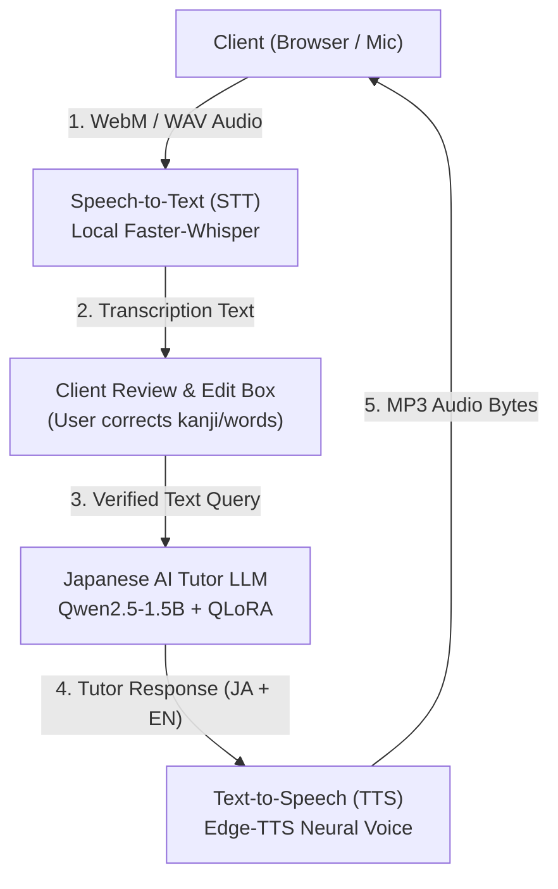

# 🎙️ Japanese AI Tutor - Voice Architecture & Privacy Guide

> [!NOTE]
> **Status: Experimental (Fully Validated End-to-End)**  
> Voice support has been tested and verified across the complete audio $\to$ transcription $\to$ LLM $\to$ TTS pipeline. It is designated as an experimental feature to indicate ongoing tuning for ambient noise resistance and diverse browser microphone hardware codecs.

This document describes the optional voice support system for the Japanese AI Tutor, including local vs. external data handling, zero-storage privacy policies, audio format compatibility, and usage instructions.

---

## 1. Architectural Overview & Component Decoupling

The voice pipeline is structured into three strictly decoupled, modular subsystems that can each be replaced, upgraded, or mocked independently:



### Component Decoupling
1. **Speech Recognition (`BaseSTTEngine` in [app/voice/stt.py](file:///home/dhanush/.gemini/antigravity-ide/scratch/japanese-ai-tutor/app/voice/stt.py)):**
   - Implemented via `FasterWhisperSTT` (local CTranslate2 engine).
   - Accepts arbitrary audio streams, files, or buffers.
   - Independent of the LLM or TTS engine.
2. **Language Model (`BaseLLMEngine` in [app/voice/llm.py](file:///home/dhanush/.gemini/antigravity-ide/scratch/japanese-ai-tutor/app/voice/llm.py)):**
   - Implemented via `TutorLLMEngine` (wrapping `app/cli_tutor.py`).
   - Uses the fine-tuned QLoRA adapter loaded on top of `Qwen/Qwen2.5-1.5B-Instruct`.
   - Agnostic to whether input was typed or transcribed from speech.
3. **Speech Synthesis (`BaseTTSEngine` in [app/voice/tts.py](file:///home/dhanush/.gemini/antigravity-ide/scratch/japanese-ai-tutor/app/voice/tts.py)):**
   - Implemented via `EdgeTTSEngine`.
   - Cleans Markdown, furigana brackets, and emojis before synthesis.
   - Selects Japanese neural voice (`ja-JP-NanamiNeural`) or English voice (`en-US-JennyNeural`).
4. **Pipeline Orchestrator ([app/voice/pipeline.py](file:///home/dhanush/.gemini/antigravity-ide/scratch/japanese-ai-tutor/app/voice/pipeline.py)):**
   - Coordinates the three engines with zero tight coupling.
   - Enforces privacy controls and transcription verification workflows.

---

## 2. Privacy Policy & Local vs. External Processing

| Subsystem | Engine / Service | Processing Location | Data Sent | Cost / Budget | Privacy Guarantee |
| :--- | :--- | :--- | :--- | :--- | :--- |
| **Speech-to-Text (STT)** | `faster-whisper` (`tiny` / `base`) | **100% Local (On-Device)** | **None** (zero network packets) | **₹0 / $0** | Audio never leaves your computer. Processed in-memory or in ephemeral temp files strictly unlinked immediately after inference. |
| **Tutor LLM** | `Qwen2.5-1.5B-Instruct` + QLoRA | **100% Local (GPU / CPU)** | **None** | **₹0 / $0** | Full local inference; model weights and prompts remain strictly private. |
| **Text-to-Speech (TTS)** | `edge-tts` (Microsoft Neural TTS) | **External Service (HTTPS)** | Only the tutor's response text | **₹0 / $0** (No API key) | Encrypted over TLS; no voice recordings are sent. Only synthesized response text is transmitted. |

### Strict Zero-Storage Guarantee
Microphone recordings are **never stored to disk** by default:
- Audio streams received by the web server are processed ephemerally.
- Any temporary decoding files created for libav/ffmpeg are wrapped in `try ... finally` blocks and unlinked immediately with `os.unlink()`.
- Audio storage can only occur if the application is started with the explicit `--store-audio` flag (disabled by default).

---

## 3. Human-in-the-Loop Transcription Review

To prevent misheard Japanese words or homophones from confusing the language model:
1. When recording stops, the audio is transcribed locally.
2. The transcript is displayed in an **editable review card** on the web interface.
3. The user can review the transcribed text, edit kanji or particles, or discard the input.
4. Clicking **"Send to Sensei 🚀"** forwards the confirmed prompt to the Japanese AI Tutor LLM.

---

## 4. Error Handling & Edge Cases

The voice system provides structured error classes ([app/voice/exceptions.py](file:///home/dhanush/.gemini/antigravity-ide/scratch/japanese-ai-tutor/app/voice/exceptions.py)) and user-facing notifications for:

| Error Scenario | Exception Class | User Notification | System Action |
| :--- | :--- | :--- | :--- |
| **Empty Audio Buffer** | `EmptyAudioError` | *"Audio recording was empty or too short. Please speak clearly into your microphone."* | HTTP 400; prompt user to re-record. |
| **Unvoiced Silence / Noise** | `NoSpeechDetectedError` | *"No intelligible speech detected in recording. Please check your microphone volume."* | HTTP 422; Silently filtered by VAD. |
| **Corrupted / Unknown Format** | `UnsupportedAudioFormatError` | *"Unsupported audio format. Please provide standard WAV, WebM, MP3, or OGG audio."* | HTTP 415; rejects corrupted payloads safely. |
| **Missing Model / Backend** | `STTResourceUnavailableError` | *"Speech recognition unavailable. Check faster-whisper installation."* | HTTP 503; diagnostic guidance logged. |
| **Microphone Permission Denied** | Browser Client Error | *"Microphone permission denied. Please allow microphone access in your browser settings."* | UI banner guides user to browser site permissions. |

---

## 5. Usage Instructions

### Starting the Voice-Enabled Web Tutor
Launch the interactive web server:
```bash
# With fine-tuned QLoRA model on GPU
.venv/bin/python app/web_tutor.py --port 7860

# Lightweight mode for development or low-resource testing
.venv/bin/python app/web_tutor.py --port 7860 --mock-llm
```
Navigate to `http://localhost:7860` in any modern web browser (Chrome, Firefox, Edge, Safari). Grant microphone permissions when prompted.

### Command-Line Voice Testing (`app/voice_cli.py`)
To test audio files or live recording from the terminal:
```bash
# Test an existing audio recording:
.venv/bin/python app/voice_cli.py --audio-file path/to/sample.wav --play-tts

# Record 5 seconds from the terminal microphone:
.venv/bin/python app/voice_cli.py --record --duration 5 --play-tts
```

---

## 6. Automated Testing

Run the full voice pipeline test suite (18 unit, integration, and API tests):
```bash
.venv/bin/python -m unittest tests/test_voice_pipeline.py -v
```
All tests verify component decoupling, error handling, text sanitization, zero disk storage, and the end-to-end audio $\to$ transcription $\to$ LLM $\to$ TTS synthesis path.
